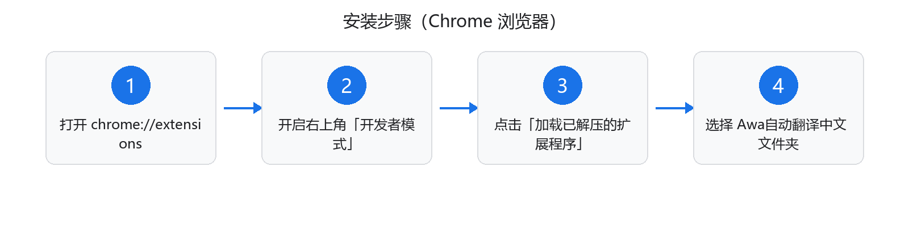

# Awa自动翻译中文 · 使用教程

> Copyright © Awa · www.akkdiy.cn

本教程分四部分：**安装** → **上手使用** → **进阶设置** → **问题排查**。全程约 3 分钟。

---

## 一、安装（约 1 分钟）

### 前提

- 电脑已安装 **Google Chrome** 浏览器（或 Edge、360 极速等 Chromium 内核浏览器）
- 已拿到本项目代码（文件夹或 zip 均可）

### 步骤

**第 1 步：打开扩展管理页**

Chrome 地址栏输入以下地址并回车：

```
chrome://extensions
```

**第 2 步：开启开发者模式**

页面右上角找到「开发者模式」开关，打开它。

**第 3 步：加载扩展**

点击页面左上角的「**加载已解压的扩展程序**」按钮，会弹出文件夹选择框。

**第 4 步：选择项目文件夹**

选中 `Awa自动翻译中文` 文件夹（注意：要选到能看到 `manifest.json` 的这一层），点击「选择文件夹」。

**第 5 步：确认安装成功**

扩展管理页出现「Awa自动翻译中文」卡片，浏览器工具栏出现蓝色「文」字图标，即安装成功。

> 如果拿到的文件是压缩包（`.zip`），需先**解压**，再加载解压后的文件夹。Chrome 不允许直接加载 zip。



---

## 二、上手使用（装完即用，无需设置）

### 场景 1：浏览英文网页

随便打开一个英文网页（如 news.ycombinator.com），稍等 1～3 秒：

- 整页文字**自动变成中文**
- 页面右下角出现控制条：`● Awa 已翻译为中文（已译 N 处）`

### 场景 2：浏览中文网页

打开中文网页时扩展**自动跳过**，不做任何翻译，也不会有控制条（不会打扰你）。

### 场景 3：想看原文

点击右下角控制条上的「**原文**」按钮，整页立即恢复原始语言；再点「**中文**」重新翻译。

### 场景 4：翻译不完整

无限滚动、懒加载的内容出现后约 0.6 秒会被**自动补翻**。如果遇到特殊情况没翻到：

- 点控制条「中文」按钮重新翻译一遍，或
- 刷新页面

---

## 三、进阶设置（点工具栏图标）

点击浏览器工具栏的扩展图标（蓝色「文」字），打开弹窗面板：

| 区域 | 说明 |
| --- | --- |
| 当前站点 | 显示正在访问的域名 |
| 翻译状态 | 等待检测 / 正在翻译 / 已翻译为中文 / 本页已是中文 等 |
| 已翻译 | 本页已翻译的文本处数 |
| 立即翻译此页 | 手动触发一次整页翻译（自动翻译被跳过时可用） |
| 恢复原文 | 整页恢复原始语言 |
| 全局自动翻译 | 总开关。关闭后所有网页都不再自动翻译 |
| 翻译当前网站 | 站点级开关。取消勾选 = 把这个网站加入「不再自动翻译」名单 |

**典型用法举例**：

- 偶尔想让某个网站保持英文练习阅读 → 在该网站点图标，取消勾选「翻译当前网站」
- 临时整个关闭自动翻译 → 关掉「全局自动翻译」

---

## 四、问题排查

| 现象 | 原因与解决 |
| --- | --- |
| 安装后网页没变化 | 安装前已打开的页面不会注入，**刷新页面**即可 |
| `chrome://` 页面、Chrome 商店页面无效 | 浏览器安全限制，任何扩展都无法注入，属正常现象 |
| 控制条显示「翻译失败」 | 网络波动导致，点控制条「中文」按钮重试 |
| 部分文字没翻译 | 有意跳过：中文内容、纯数字、代码块、隐藏元素；或刷新页面重试 |
| iframe 内嵌页面没翻译 | 扩展已支持 iframe，个别网站（如某些登录框）可能因嵌套过深而漏翻 |
| 想查看已翻译处数 | 看控制条文字或扩展弹窗中的「已翻译」 |
| 换电脑/重装系统 | 把项目文件夹（或 zip）复制过去，重新按「一、安装」操作即可 |

---

## 五、卸载

1. 打开 `chrome://extensions`
2. 找到「Awa自动翻译中文」卡片
3. 点卡片上的「**移除**」按钮即可

卸载不影响任何系统文件，刷新网页后全部恢复原样。

---

© Awa · [www.akkdiy.cn](https://www.akkdiy.cn)
